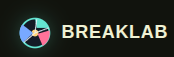
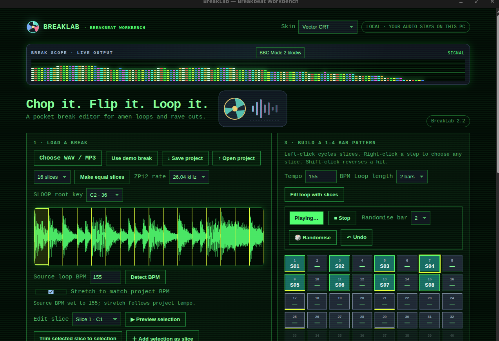
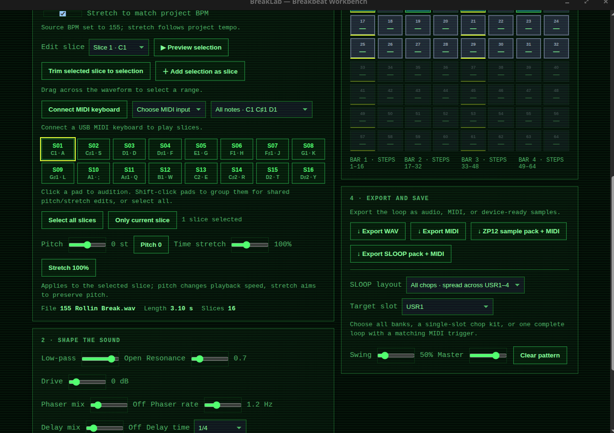
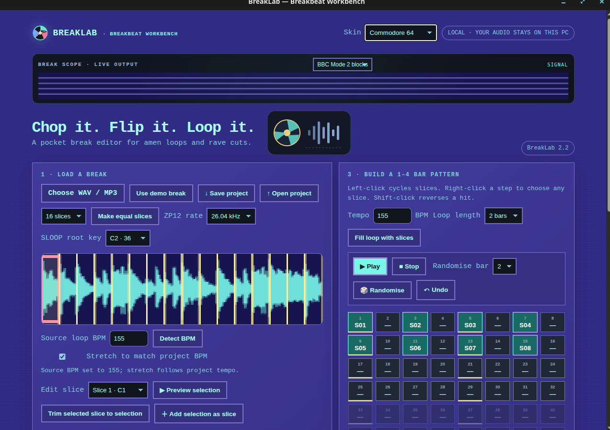
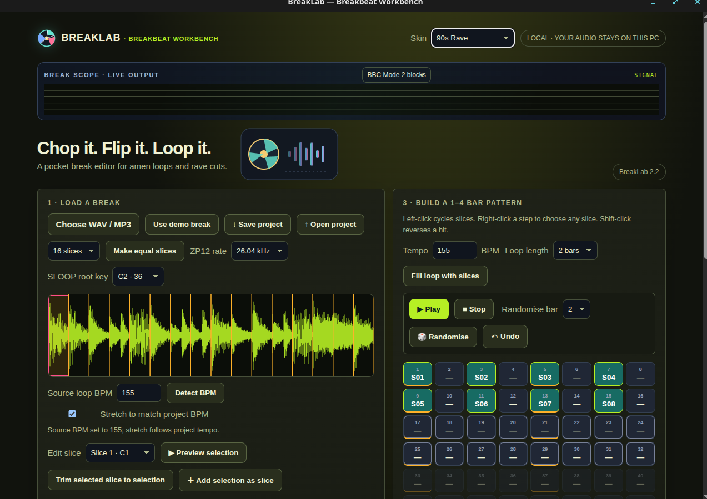
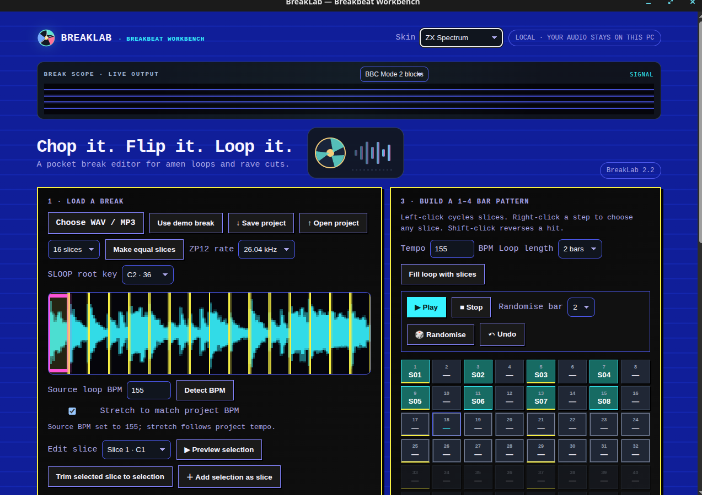

# BreakLab

**Chop it. Flip it. Loop it.** BreakLab is a local-first break editor for making quick loops, slicing breaks, auditioning chops from a MIDI keyboard, and exporting material for samplers such as the M-VAVE FM-1/ZP12 and SLOOP.

## Screenshots

The Linux desktop build running with the main editor and several retro skins:

## Run it

Open index.html in Brave, Chromium, or Chrome. Audio is processed in your browser and stays on your computer.

For MIDI input, use a Chromium-based browser, connect the keyboard before opening BreakLab, then choose **Connect MIDI keyboard** and select its input.

## Self-host with Docker

The container serves the same standalone app as a small website. It does not store uploaded audio or project files; those stay in the browser.

1. Install Docker Engine and the Docker Compose plugin on the host.
2. Download and extract this repository, then open a terminal in its folder.
3. Start BreakLab:

   docker compose up -d --build

4. Open [http://localhost:8080](http://localhost:8080) on the host machine. To use it from another device on your home network, open http://HOST-IP:8080.

Set a different host port by creating a .env file in the project folder with BREAKLAB_PORT=8090, then run the same command and visit port 8090. Stop the service with docker compose down.

**MIDI note:** Web MIDI requires a secure browser context. http://localhost is treated as secure by supporting browsers, but a plain HTTP LAN address may not expose MIDI. For MIDI from another device, put the container behind an HTTPS reverse proxy. WAV/MP3 editing and exports can still be used from the LAN address without MIDI.

## Install the Linux desktop launcher

The launcher opens BreakLab in an app-style Chromium/Brave window. It does not require Node, Electron, or an internet connection after download. You need one of Brave, Chromium, or Google Chrome installed.

1. Download and extract this repository.
2. Open a terminal in the extracted repository folder (usually breaklab-workbench-main if downloaded as a ZIP).
3. Run:

   bash install-linux.sh

4. Find **BreakLab** in the Applications menu. To remove it later, run bash uninstall-linux.sh from the extracted folder.

## Features

- Load WAV or MP3 breaks, detect/correct source BPM, and stretch to the project tempo.
- Create equal or hand-drawn uneven slices; preview, trim, and add slices.
- Trigger slices with a computer keyboard or external MIDI keyboard. Chromatic mapping includes black keys.
- Set slice start/end points, pitch, and time stretch; apply pitch/stretch to selected slices together.
- Shape sound with filter, resonance, drive, phaser, tempo-synced delay, and reverb.
- Build 1–4 bar patterns with per-bar randomisation, swing, reversal, undo, and MIDI export.
- Export processed WAV loops, 12-bit ZP12 sample packs, and SLOOP sample packs with matching MIDI.
- Choose retro skins including BBC Micro, ZX Spectrum, Atari ST, Amiga Workbench, Commodore 64, Vector CRT, and 70s/80s/90s looks.
- Save and reopen .bbwp projects. Skin and Break Scope preferences are remembered in the browser.

## Audio and device notes

BreakLab is an editor/exporter; it does not directly write samples to the FM-1. Export the sample pack, then load the WAVs and MIDI using the device's firmware/editor workflow. Browser Web MIDI availability depends on the browser and device permissions. Bluetooth audio can add audible latency; wired audio is best for timing-critical use.

## Contributing

Bug reports, feature ideas, and pull requests are welcome. Keep changes self-contained where possible so the single-file browser version remains easy to run.

## License

BreakLab is distributed under the GNU General Public License v3.0 or later. See [LICENSE](LICENSE).
